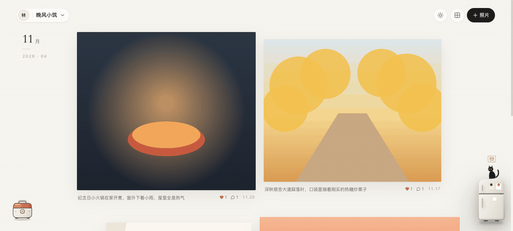
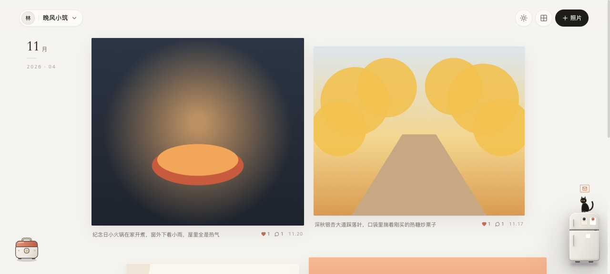
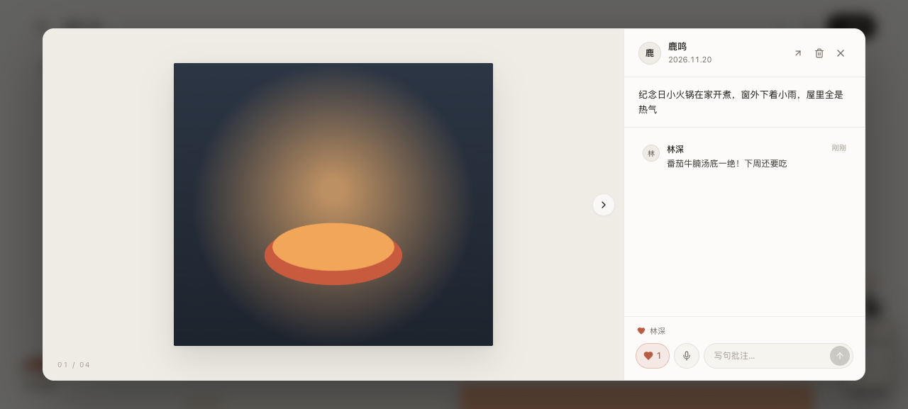
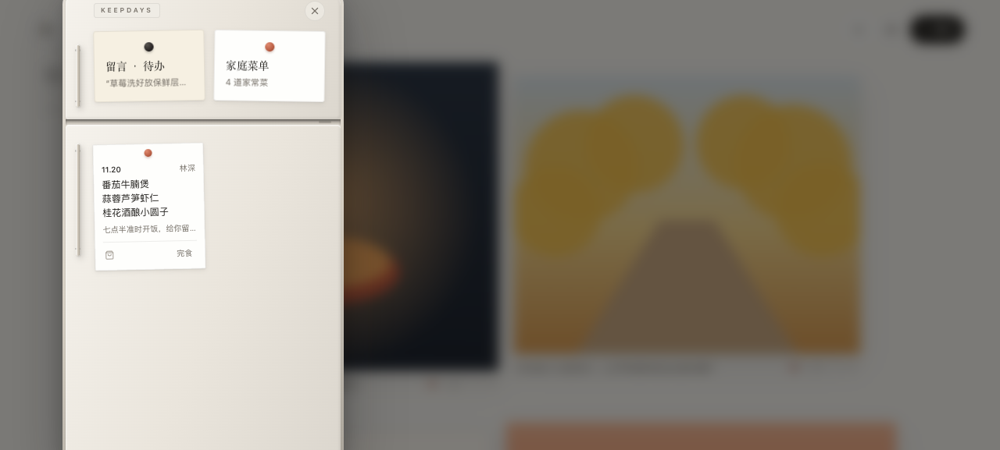
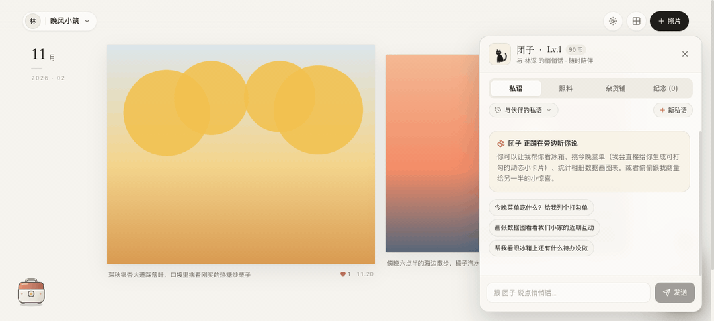
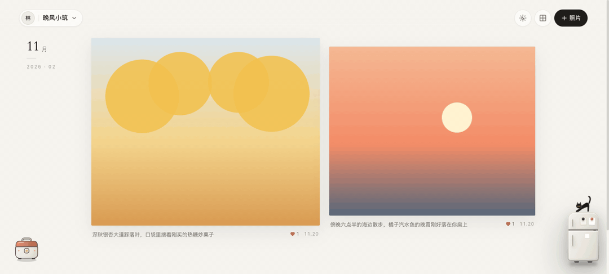

<div align="center">

# KeepDays · 留白小家

**把柴米油盐与日常心动，安放在一间只属于你们的数字小家**

专为情侣、家人与挚友打造的私密共享生活空间  
无界拍立得照片墙 · 厨房双门冰箱 · 随昼夜流转的自然光影 · 住在冰箱顶上的灵性陪伴伙伴

[](https://github.com/xai-org/grok-build)
[](#)
[](#)

<br />



</div>

---

## ✨ 为什么选择 KeepDays？

在信息过载的社交广场之外，**KeepDays** 为亲密关系留出了一间安静、温暖、有生活气息的「线上自宅」。每一次传图、每一张便签、每一顿晚饭的商量，都会实时同步在你们共同生活的画面里。

### 1. 满屏拍立得照片墙 · 即拍即上墙，双端实时同频
- **像真实相册一样自由陈列**：支持照片、实况动态瞬间与地点印记，点开即可查看专属你们两人的朋友圈式互动卡片。
- **微信般丝滑的无等待体验**：无论是上传高清照片、敲下一句心情留言，还是录一段 15 秒的语音悄悄话，点击瞬间即刻上墙展示，后台静默完成同步，绝不卡顿等待。
- **同屋微感知**：当另一半正在翻看某张旧照片或打开冰箱门时，画面会亮起柔和的呼吸微光，隔着屏幕也能感受到彼此在场。

<p align="center">
  
  &nbsp;
  
</p>

---

### 2. 会呼吸的厨房立体冰箱 · 装下三餐四季的仪式感
- **今日菜单贴上墙**：把两个人都爱吃的拿手菜收进家庭菜单，每天勾选几道贴上冰箱门，还能一键把所需食材转入买菜待办。
- **手写便签与定时胶囊**：「草莓洗好放第二格啦」「周五晚上一起看老电影」——支持彩色便签与**定时显影便签**（不到约定时刻呈毛玻璃遮盖，为纪念日留足惊喜）。
- **随北京时间流转的昼夜光影**：清晨是通透的棉麻暖白，傍晚染上落日微醺，深夜则自动调暗屋灯、点亮冰箱门缝的一缕柔光。

<div align="center">
  
</div>

---

### 3. 住在冰箱顶上的灵性陪伴伙伴（基于 `grok-build` 二次开发）
你们可以在共享小家中共同领养一只住在冰箱顶上的小生命（**黑猫、小柴犬、水獭或垂耳兔**）。它不仅会在照片墙间散步、打盹、把压箱底的老照片叼回来唤起回忆，更是一位懂分寸、有记忆的智能生活伙伴：

> **核心说明**：平台内的智能陪伴 Agent 引擎基于开源项目 **[grok-build](https://github.com/xai-org/grok-build)** 进行深度定制与二次开发得来，针对亲密共享生活场景打造了专属的记忆体系与动态交互体验。

- **悄悄话严格保密，共同生活默契共享**：你和宠物单独聊的私房话（比如偷偷筹备纪念日礼物）仅对你自己可见，绝不会向另一半剧透；而两人的饮食忌口、纪念日与生活习惯则会沉淀为小家的共同记忆。
- **对话里直接弹出可交互小卡片**：问它「今晚吃什么？」，它会在聊天气泡里直接摆出可打勾的点菜单，勾选完自动帮你贴上冰箱门；也能随时为你绘制小家近期互动统计图。
- **双人同频照料**：顺毛、逗玩、散步寄回纪念明信片，还能「一人开罐头、另一人添勺」完成双人接力投喂。

<div align="center">
  
</div>

---

### 4. 左下角拟物迷你工具箱 · 免填繁琐配置，即插即用
我们将所有进阶设置都收纳进了左下角一只安静可爱的**迷你实体工具箱**里（鼠标轻触还会悄悄探出小扳手）：
- **一键切换主流大模型**：内置 DeepSeek、MiniMax、Kimi、智谱 GLM、通义千问、豆包、硅基流动、Claude、OpenAI、Gemini、Grok、OpenRouter 等主流厂商卡片——**无需手动填写接口地址，无需手敲模型名**，填入密钥后自动拉取官方最新模型下拉列表，连通即亮绿灯，异常即红框提示原因。
- **记忆透明可查可改**：随时以简洁的 Markdown 文档查看或亲手修改小家的「公共记忆」与「个人私密记忆」，支持历史版本一键回退。
- **外部能力热插拔（MCP）**：支持一键接入天气预报、Gmail 邮箱、日程日历、地图路线、联网搜索等外部工具服务，让冰箱顶上的小家伙拥有实时联网办事能力。

<div align="center">
  
</div>

---

## 📖 平台使用指南

### 第一步：入住并开启你们的共享小家
1. 打开平台注册账号后，每位成员都会获得一个专属的 **「门牌号」**（如 `#89757`），并默认拥有一间独立的「个人空间」。
2. 点击左上角空间切换栏，新建一间 **「共享小家」**（例如取名 *晚风小筑*），输入另一半的门牌号发出邀请；对方点击确认后，两人即可正式同住一屋。

### 第二步：记录照片墙与声音回忆
1. 点击右上角 **「上传照片」**（或直接拖入照片），写下一句当下的心情或拍摄地点，照片会立即呈现在画布上。
2. 点击任意拍立得照片即可点亮爱心、发送文字批注或录制语音留言；在「个人空间」拍下的满意瞬间，也可以一键冲洗投递到两人的共享小家中。

### 第三步：打理厨房冰箱与今日菜单
1. 点击画面右下角的**立体双门冰箱**即可打开厨房面板。
2. 在 **「家庭菜单」** 中录入你们常吃的菜品；每天在 **「今日菜单」** 里打勾挑选今晚想吃的菜贴上冰箱门，需要买菜时点一下即可同步进待办清单。
3. 在 **「留言待办板」** 随时贴上温馨便签，勾选开启「定时解锁」即可制作纪念日惊喜胶囊。

### 第四步：领养与唤醒冰箱顶上的小家伙
1. 点击冰箱顶上的小窝完成领养仪式，为它取一个喜欢的名字。
2. 在 **「私语」** 页签中直接和它聊天：无论是商量晚饭菜单、查询冰箱待办、统计小家生活点滴，还是查询实时天气，它都会在气泡内流式回应或为你生成交互卡片。
3. 在 **「照料」** 与 **「杂货铺」** 中，日常上传照片、贴菜单与留言都会自动积攒「爪印币」，可用来为它兑换三文鱼冻干、瓦楞纸箱窝或小红围巾。

### 第五步：在左下角工具箱配置模型与扩展能力
1. **配置大模型**：点击左下角迷你工具箱 -> **「模型」**，点选任意偏好的厂商卡片，粘贴对应的 API Token，在自动拉取的下拉框中选定模型即可热切换生效（即使暂不配置密钥，也可直接使用内置本地陪伴模式体验核心互动）。
2. **管理记忆**：切换到 **「记忆」** 页签，可直接阅读、编辑或回退伙伴记住的「公共记忆」与「私密记忆」。
3. **接入扩展服务（MCP）**：切换到 **「MCP」** 页签，粘贴远程服务地址（如天气服务 `https://...`）、本地命令或标准 JSON 配置即可热挂载扩展技能；需要授权的服务（如邮箱、日程等）点击展开下方认证栏填入密钥即可连通。

---

## 🚀 本地快速体验

如果您希望在自己的电脑或私有服务器上独立运行一套专属小家：

1. **准备前端画面**
   ```bash
   cd frontend && npm install && npm run build
   ```
2. **启动小家服务**
   ```bash
   cd ../backend && cp .env.example .env && cargo run --release
   ```
3. 打开浏览器访问 **`http://127.0.0.1:3000`** 即可入住体验。  
   *(如需一键打包部署至个人云服务器，可直接参考 `deploy/` 目录下的自动化部署脚本。)*

---

## 🙏 致谢与说明

- KeepDays 平台中的**智能陪伴 Agent 核心部分基于开源项目 [grok-build](https://github.com/xai-org/grok-build) 二次开发得来**，在此向原项目及开源社区致以诚挚感谢。
- 愿每一个平凡的日子，都有回响，都有留白。
